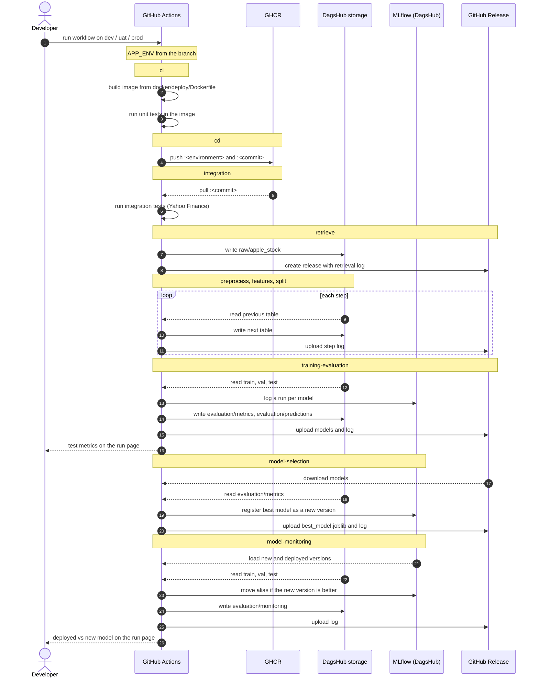

# Deployment

How the pipeline is built, tested, published and run in each environment, and where its outputs go.

## Overview

| Part | Tool | Where |
|---|---|
| Code and CI/CD | GitHub Actions | [`.github/workflows/cicd.yml`](../.github/workflows/cicd.yml) |
| Images | Docker, GitHub Container Registry | `ghcr.io/andmanousakis/stock-extreme` |
| Tables | Parquet on DagsHub storage (S3-compatible) | `<bucket>/<environment>/<table>/` |
| Experiments and models | MLflow on DagsHub | experiment `stock-extreme`, model `stock-extreme-model` |
| Logs and model files per run | GitHub Releases | tag `data-<environment>-<date>-<commit>-r<run>.<attempt>` |

## Flow



## Environments

The environment comes from the branch and is passed to every container as `APP_ENV`. That selects the configs in `configs/<environment>/` and the storage prefix `<bucket>/<environment>/`.

| Branch | Environment |
|---|---|
| `prod` | prod |
| `uat` | uat |
| any other branch | dev |

The configs differ only in these settings:

| Setting | dev | uat | prod |
|---|---|---|---|
| Data from | 2005-01-01 | 1990-01-01 | 1990-01-01 |
| Download retries | 3 | 5 | 5 |
| Log level | DEBUG | INFO | INFO |

Changes are promoted through pull requests: `dev` → `uat` → `prod`. Pushes and pull requests don't start the workflow. To run the pipeline in an environment, open **Actions → CI/CD → Run workflow** on GitHub and pick that branch.

## CI/CD

The workflow has ten jobs that run in sequence. Each job runs only if the previous one succeeded.

```
ci > cd > integration > retrieve > preprocess > features > split > training-evaluation > model-selection > model-monitoring
```

| Job | What it does |
|---|---|
| `ci` | Builds the image and runs the unit tests in it |
| `cd` | Pushes the image to GHCR as `:<environment>` and `:<commit>` |
| `integration` | Pulls `:<commit>` and runs the integration tests against Yahoo Finance |
| `retrieve` | Downloads prices, writes the raw table and creates the run's release |
| `preprocess` | Writes the clean table |
| `features` | Writes the feature table |
| `split` | Writes the train, val and test tables |
| `training-evaluation` | Trains and scores the models, logs them to MLflow, writes the evaluation tables and adds the test metrics to the run page |
| `model-selection` | Picks the best model of the run and registers it as a new version |
| `model-monitoring` | Scores the deployed and new versions on the same data, moves the alias if the new one is better, writes the monitoring table and adds the comparison to the run page |

Every job after `cd` runs the same image, `:<commit>`, so all steps use exactly the code that passed `ci`. Docker layers are cached between jobs and runs with the GitHub Actions cache.

Each run gets a `PIPELINE_RUN_ID` of the form `r<run number>.<attempt>`. It is used in the table file names, in the evaluation tables and in the release tag, so re-runs never overwrite each other.

## Docker

| File | Used by | Notes |
|---|---|
| [`docker/deploy/Dockerfile`](../docker/deploy/Dockerfile) | GitHub Actions | Copies the code, configs, schemas and tests into the image. Runs steps 1 to 6 by default. |
| [`docker/local/Dockerfile`](../docker/local/Dockerfile) | `make` | Editable install. The project folder is mounted, so code changes apply without a rebuild. |
| [`docker/local/docker-compose.yml`](../docker/local/docker-compose.yml) | `make` | Runs the unit and integration tests, then steps 1 to 6, as your user, with `APP_ENV=dev` |

Both images use Python 3.11, CPU-only PyTorch and dependencies pinned in [`pyproject.toml`](../pyproject.toml).

## Storage

[`utils/storage_io.py`](../utils/storage_io.py) reads and writes every table as Parquet:

```
<bucket>/<environment>/<table>/<UTC timestamp>_<run id>.parquet
```

- Every run adds a new file instead of overwriting, so the history of each table is kept.
- By default a read returns the latest file. It can also return a given run, or all runs together, which model selection and monitoring use to read the metrics.
- If `STORAGE_BUCKET` is not set, the same layout is written under the local `data/` folder. The unit tests run this way.

Tables:

| Table | Written by |
|---|---|
| `raw/apple_stock` | retrieval |
| `interim/apple_stock_clean` | preprocessing |
| `processed/apple_stock_features` | feature engineering |
| `processed/train`, `processed/val`, `processed/test` | split |
| `evaluation/metrics`, `evaluation/predictions` | training and evaluation |
| `evaluation/monitoring` | model monitoring |

## MLflow

Tracking is on only when `MLFLOW_TRACKING_URI` is set. Without it, the pipeline runs the same way but logs nothing to MLflow.

- **Experiment `stock-extreme`.** One run per model, with its settings, metrics for each split, training curves, plots and the model itself as a pyfunc model.
- **Registered model `stock-extreme-model`.** Every pipeline run registers its best model as a new version, tagged with its run ID and its val and test scores. The `dev`, `uat` and `prod` aliases point at the version that environment currently serves; only model monitoring moves them. To load it:

```python
import mlflow

model = mlflow.pyfunc.load_model("models:/stock-extreme-model@prod")
```

## Releases

The `retrieve` job creates one GitHub release per run, and each later job adds to it:

- a log for each step
- the trained models (`*.joblib`)
- `best_model.joblib`

Tables are not attached, since they live on DagsHub storage.

## Secrets

These are GitHub repository secrets. For `make` runs they go in a local `.env` file, which is excluded from git and from the images.

| Secret | Used for |
|---|---|
| `MLFLOW_TRACKING_URI`, `MLFLOW_TRACKING_USERNAME`, `MLFLOW_TRACKING_PASSWORD` | MLflow on DagsHub |
| `STORAGE_BUCKET`, `AWS_ENDPOINT_URL`, `AWS_REGION` | DagsHub storage location |
| `AWS_ACCESS_KEY_ID`, `AWS_SECRET_ACCESS_KEY` | DagsHub storage credentials (the DagsHub token) |

`GITHUB_TOKEN` is provided by GitHub Actions and is used to push images and create releases.

## Local runs

1. Optionally, create `.env` in the project root with the secrets above. Without it, tables go to `data/` and nothing is logged to MLflow.
2. Run:

```bash
make stock-extreme-dev-build-up
make stock-extreme-dev-logs
```

Local runs always use dev. See the [README](../README.md) for all `make` commands.
