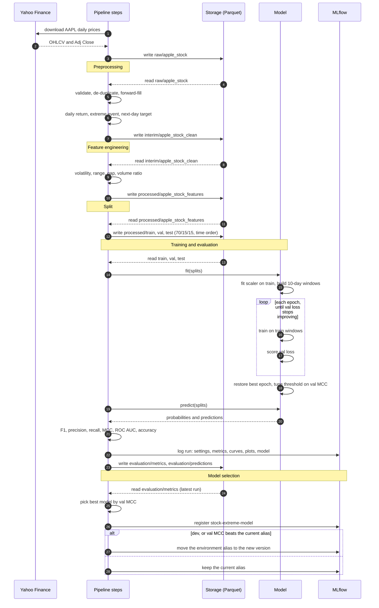

# Modelling

How the data is prepared and how the model is trained, scored and selected. Settings below are from `configs/prod/`; dev uses a shorter date range.

## Problem

Predict whether tomorrow will be an **extreme day** for Apple (AAPL) stock, using only data up to today. A day is extreme when its absolute daily return is above 2%, in either direction.

This is a binary classification problem with imbalanced classes: most days are not extreme.

## Flow



## Data

Daily prices are downloaded from Yahoo Finance (`yfinance`) from 1990 to the latest trading day (from 2005 in dev). Columns: `Date`, `Open`, `High`, `Low`, `Close`, `Adj Close` and `Volume`. The raw data is checked against the schema in `schemas/` before it is stored.

## Preprocessing

[`src/pipeline/2_data_preprocessing.py`](../src/pipeline/2_data_preprocessing.py):

1. **Schema validation.** Checks that the columns exist and casts them to the schema dtypes.
2. **Sort and de-duplicate.** Sorts by date and keeps the last row for each date.
3. **Missing values.** Forward-fills gaps from the previous trading day. Weekends and holidays are not added, since no price exists for them. Leading rows that can't be filled are dropped.
4. **Daily return.** Percentage change of `Adj Close`, so that splits and dividends don't show up as fake moves.
5. **Extreme event.** `1` if `|daily_return| > 2`, else `0`.
6. **Target.** `extreme_event_next_day` is the next day's extreme event label. The last day has no next day, so it is dropped.

## Features

[`src/pipeline/3_feature_engineering.py`](../src/pipeline/3_feature_engineering.py). Each feature uses only the current and earlier days:

| Feature | Definition |
|---|---|
| `daily_return` | Percentage change of `Adj Close` from the previous day |
| `volatility_5`, `volatility_10`, `volatility_20` | Rolling standard deviation of `daily_return` over 5, 10 and 20 days |
| `range` | `(High - Low) / Close × 100`, the intraday swing |
| `gap` | `(Open - previous Close) / previous Close × 100`, the overnight jump |
| `volume_ratio` | `Volume` divided by its 20-day rolling mean |

The first days don't have enough history for the rolling features, so they are dropped. Raw prices are kept in the table, but the model uses only the seven features above. Prices trend over decades, so they would not mean the same thing in train as they do in test.

## Split

[`src/pipeline/4_data_split.py`](../src/pipeline/4_data_split.py) splits the data in time order, without shuffling:

| Split | Share | Used for |
|---|---|---|
| train | 70% (oldest) | fitting the scaler and the network |
| val | 15% | early stopping, threshold tuning and model selection |
| test | 15% (newest) | reporting only |

The test set is never used to make a decision, so its scores are an honest estimate on unseen, later data.

## Model

### Input windows

[`utils/windowing.py`](../utils/windowing.py) builds a sample for each day from the 10 days that end on it. Each sample is shaped `[features, days]`, and its label is that last day's target.

The first windows of val and test can look back into the end of the previous split for their input days. Each window belongs to the split of its last day, so a target never crosses splits.

The features are standardised with a `StandardScaler` that is fitted on train only and then applied to all three splits.

### Network

[`src/models/networks/temporal_cnn.py`](../src/models/networks/temporal_cnn.py):

```
input [7 features × 10 days]
  → Conv1d(7 → 8, kernel 3) → ReLU → Dropout(0.5)
  → Conv1d(8 → 16, kernel 3) → ReLU → Dropout(0.5)
  → Flatten → Linear(16 × 10 → 2)
```

The convolutions slide over the days, so the network can learn short patterns such as rising volatility or a big gap. The network is kept small on purpose, because the signal is weak and a larger one overfits.

### Training

[`src/models/temporal_cnn.py`](../src/models/temporal_cnn.py):

- **Loss.** Cross-entropy, weighted by inverse class frequency on train, so that missing an extreme day costs more than a false alarm.
- **Optimiser.** Adam with learning rate 0.0003 and weight decay 0.0001, batch size 32, and a fixed seed.
- **Early stopping.** Training runs for at most 200 epochs and stops after 15 epochs without a lower val loss. It then restores the weights from the best epoch.
- **Decision threshold.** Instead of using 0.5, it tries thresholds from 0.05 to 0.95 on val and keeps the one with the highest MCC.

All of these settings are in `config-model-training-eval.yaml`. To add a model, add an entry under `models:` with its class and params. Each class must provide `fit`, `predict_proba` and `predict`.

## Evaluation

[`src/pipeline/5_model_training_evaluation.py`](../src/pipeline/5_model_training_evaluation.py) scores every model on train, val and test:

| Metric | What it shows |
|---|---|
| F1 | Balance of precision and recall for the extreme class |
| Precision | Share of predicted extreme days that really were extreme |
| Recall | Share of extreme days that were caught |
| MCC | Correlation between predictions and truth, from -1 to 1, with 0 for no skill |
| ROC AUC | How well the probabilities rank extreme above normal days, regardless of the threshold |
| Accuracy | Share of correct predictions; misleading on its own because the classes are imbalanced |

The metrics and every prediction are written to the `evaluation/metrics` and `evaluation/predictions` tables, tagged with the pipeline run ID and date. Each model is also logged to MLflow with its settings, metrics, training curves (train and val loss and val F1 by epoch), confusion matrices, ROC curves and precision-recall curves.

### Why MCC

On imbalanced data, F1 can be pushed up by predicting every day as extreme: recall becomes 100% and precision equals the base rate. An earlier version did exactly that. MCC is 0 for any constant prediction, so a model only scores well if it really tells the two classes apart. MCC is therefore used for threshold tuning, model selection and registry promotion.

## Selection

[`src/pipeline/6_model_selection.py`](../src/pipeline/6_model_selection.py) reads the metrics of the latest run and picks the model with the highest val MCC. It saves that model as `models/best_model.joblib` and registers it in MLflow as `stock-extreme-model`, with the environment (`dev`, `uat` or `prod`) as its alias.

In dev the alias always moves to the new model. In uat and prod it moves only if the new model's val MCC beats the current one.

## Limitations

- **Weak signal.** Daily moves are close to unpredictable. The features mostly capture volatility clustering (big moves tend to follow big moves), not the cause of a move.
- **No event data.** Earnings dates, macro releases and market-wide indicators such as the VIX or the S&P 500 are not used, although they drive many extreme days.
- **One split.** Performance comes from a single train/val/test cut. Market regimes change, so walk-forward validation would give a more reliable estimate.
- **Fixed 2% cutoff.** The same threshold means something different in a calm year than in a volatile one.
